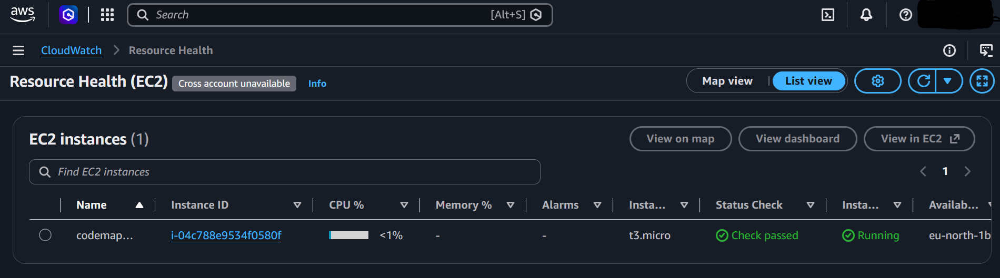

# Deploying Code-Mapper on AWS

Code-Mapper's three services (graph-service, qa-service, gateway) run with Docker Compose on a single
EC2 instance. The instance, firewall and SSH key are defined in Terraform (`terraform/`), so the whole
environment can be created and destroyed with one command each.

## Architecture

```
 my IP ──HTTP :8000──►  EC2 t3.micro (Ubuntu 24.04, eu-north-1)
 my IP ──SSH  :22────►    └─ Docker Compose
                              ├─ gateway        :8000  (FastAPI, public)
                              ├─ graph-service  :50051 (gRPC, internal)
                              └─ qa-service     :50052 (gRPC, internal) ──HTTPS──► Gemini API
```

The instance as it appeared in the AWS console after `terraform apply`:



Terraform creates three resources:

| Resource | Purpose |
|---|---|
| `aws_instance` | `t3.micro`, Ubuntu 24.04, 20 GB encrypted gp3 disk, IMDSv2 only. `user_data` installs Docker and adds 2 GB swap (the instance has under 1 GB of RAM). |
| `aws_security_group` | Allows SSH (22) and the gateway (8000) **from one IP address only**. |
| `aws_key_pair` | The public half of a dedicated SSH key. The private key never leaves my machine. |

## Design decisions

- **One EC2 instance, not EKS.** The EKS control plane costs about $0.10/hour and is not covered by the
  free plan. The Kubernetes manifests in `k8s/` are tested on minikube instead. At this scale a single
  VM gives the same lessons (networking, firewalling, deployment) at no cost.
- **Narrow firewall.** Only the gateway port is opened, and only to my IP. The gRPC ports 50051 and
  50052 are used between containers and are not reachable from the internet.
- **Secrets stay out of git.** The Gemini key lives in `.env` on the server. `terraform.tfvars`, state
  files and `*.pem` are in `.gitignore`.
- **Short-lived credentials.** AWS access uses `aws login` (browser sign-in, temporary credentials)
  rather than long-lived access keys.
- **Everything is reproducible.** `terraform destroy` removes the whole environment, so nothing keeps
  consuming free-plan credit when it is not in use.

## Prerequisites

- An AWS account on the Free plan, and the AWS CLI v2 (`aws login`)
- Terraform 1.5 or later
- An SSH key pair: `ssh-keygen -t ed25519 -f ~/.ssh/codemapper-key`
- A Gemini API key

## Deploy

1. Sign in and create the infrastructure. The Terraform AWS provider cannot read `aws login` profiles
   directly, so export temporary credentials first (PowerShell shown):

   ```
   aws login --profile codemapper
   aws configure export-credentials --profile codemapper --format powershell | Invoke-Expression
   cd terraform
   copy terraform.tfvars.example terraform.tfvars   # set my_ip_cidr to your public IP, e.g. "203.0.113.5/32"
   terraform init
   terraform plan
   terraform apply
   ```

   The outputs include `public_ip` and a ready-made `ssh_command`.

2. Install the app on the server (Docker is already installed by `user_data`):

   ```
   ssh -i ~/.ssh/codemapper-key ubuntu@<public_ip>
   git clone https://github.com/5ahar-K/CodeMapper_advanced_version app
   cd app
   git clone --depth 1 https://github.com/pallets/click.git sample_repo
   printf 'REPO_PATH_ON_YOUR_COMPUTER=/home/ubuntu/app/sample_repo\nGEMINI_API_KEY=<your key>\n' > .env
   docker compose up -d --build
   ```

   `sample_repo/` is git-ignored, so it has to be created on the server. The graph-service Dockerfile
   copies it in at build time, so clone it before building.

3. Check it:

   ```
   curl http://<public_ip>:8000/health      # {"status":"ok"}
   ```

   Open `http://<public_ip>:8000/docs` in a browser for the Swagger UI.

## Update a running deployment (manual)

```
ssh -i ~/.ssh/codemapper-key ubuntu@<public_ip>
cd app && git pull && docker compose up -d --build
```

Deployment is manual because the firewall only allows SSH from one IP, so a hosted CI runner could not
reach the server. In production I would use SSM Session Manager or a self-hosted runner instead of
opening port 22.

## Tear down

```
cd terraform
terraform destroy
```

Then check the EC2 console for leftover instances, volumes or Elastic IPs.

## Cost

The account is on the AWS Free plan, so usage is paid from credits and the account cannot be charged
unless I upgrade it. A `t3.micro` left running uses roughly $8 to $10 of credit a month. I destroy it
when I am not using it.

## What I would change for production

- Managed Kubernetes (EKS) or ECS instead of a single VM, with the existing `k8s/` manifests
- An Application Load Balancer with HTTPS (ACM certificate) instead of a raw IP on port 8000
- The Gemini key in AWS Secrets Manager, read through an IAM instance role
- Images built in CI and stored in ECR, rather than built on the server
- Remote Terraform state (S3 with locking) and CloudWatch logs and alarms
- No SSH at all: SSM Session Manager for access
